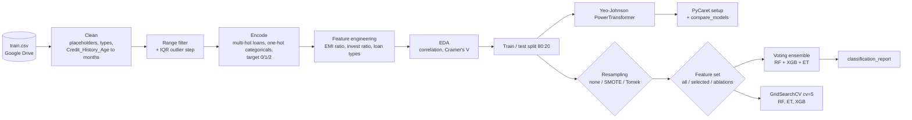
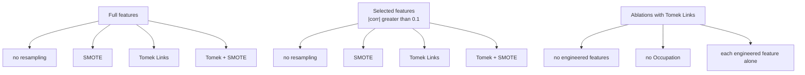

<div align="center">

# Bank Credit Analysis and Prediction

**Notebook study of customer credit-score classification (Poor / Standard / Good): data cleaning, class-imbalance handling, feature selection, PyCaret model comparison and a tuned ensemble.**

    

</div>

<p align="center">
  
</p>

> **Status: exploratory notebook (file name `FDS_credit_bank.ipynb`; the meaning of FDS is not stated), not a deployed system.** The dataset is not included in the repository, and the committed notebook has no saved outputs, so no accuracy figures can be quoted from it.

Last updated: 2026-11-03.

**Presentation:** <https://canva.link/te3ms6flstxe274>

## สรุปภาษาไทย

โปรเจกต์นี้เป็นโน้ตบุ๊กวิเคราะห์และสร้างโมเดล Machine Learning เพื่อจำแนกระดับเครดิตของลูกค้าธนาคาร (3 คลาส: Poor, Standard, Good) เพื่อช่วยให้การพิจารณาสินเชื่อมีข้อมูลสนับสนุนและลดความเสี่ยงหนี้ที่ไม่ก่อให้เกิดรายได้ (NPL) ขั้นตอนหลักคือ ทำความสะอาดข้อมูล (ค่าผิดปกติ ค่าที่หายไป แปลง Credit History Age เป็นเดือน), สร้างฟีเจอร์ใหม่ (สัดส่วนหนี้ต่อรายได้ ฯลฯ), จัดการข้อมูลไม่สมดุลด้วย SMOTE / Tomek Links, คัดฟีเจอร์ด้วยค่าสหสัมพันธ์, เปรียบเทียบโมเดลด้วย PyCaret, ทดลอง Voting Ensemble (Random Forest + XGBoost + Extra Trees) และปรับจูนด้วย GridSearchCV รันบน Google Colab โดยใช้ไฟล์ `train.csv` ที่เก็บใน Google Drive (ไม่อยู่ใน repo) ผลลัพธ์ตัวเลขไม่ได้บันทึกไว้ในโน้ตบุ๊ก ต้องรันใหม่เพื่อดู

---

## Problem

Banks must decide which customers are creditworthy. Poor credit decisions produce non-performing loans (NPLs). This project explores how well customer financial and behaviour attributes predict a three-level credit score, and which preprocessing choices (imbalance handling, feature selection) matter.

## Approach and design choices

| Step | What the notebook does |
|---|---|
| Cleaning | Replaces placeholder tokens (`_______`, `!@9#%8`, `nan`, trailing underscores), drops `ID`, `Customer_ID`, `Month`, `Name`, `SSN` and rows with missing values, casts string-typed numbers to float/int. |
| Parsing | Converts `Credit_History_Age` ("22 Years and 9 Months") to months. |
| Range filter | Drops rows with negative balances, delays, loan counts or impossible ages (<0 or >125). |
| Encoding | Multi-hot encodes `Type_of_Loan`; one-hot encodes `Occupation`, `Credit_Mix`, `Payment_of_Min_Amount`, `Payment_Behaviour`; maps `Credit_Score` Poor/Standard/Good to 0/1/2. |
| Feature engineering | `ratio_de_month` (EMI / salary), `ratio_invest_month` (invested / salary), `total_loan_type`. |
| EDA | Class distribution, correlation heatmap, Cramer's V for categorical features, per-class distributions. |
| Imbalance | Compares no resampling, SMOTE, Tomek Links (majority) and Tomek + SMOTE. |
| Feature selection | Drops columns with absolute correlation to `Credit_Score` <= 0.1; ablations without feature engineering and without Occupation. |
| Scaling | Yeo-Johnson `PowerTransformer` fitted on the training split. |
| Models | PyCaret `setup` + `compare_models`; a soft `VotingClassifier` of RandomForest, XGBoost and ExtraTrees; `GridSearchCV` (cv=5) for RF, ET and XGBoost parameter grids. |

---

## Repository layout

```
Credit-bank/
├── FDS_credit_bank.ipynb   the whole study (115 cells)
└── README.md
```

## Tech stack

| Area | Choice (from notebook imports) |
|---|---|
| Environment | Google Colab (mounts Google Drive) |
| Data / EDA | pandas, numpy, matplotlib, seaborn, scipy (`chi2_contingency`) |
| Modelling | scikit-learn (RandomForest, ExtraTrees, Voting/Stacking, GridSearchCV, PowerTransformer), XGBoost, PyCaret |
| Imbalance | imbalanced-learn (SMOTE, TomekLinks) |

---

## Pipeline



## Experiment matrix



Every cell is evaluated by `train_test_model(col=[...], method=...)`, which prints a classification report (precision, recall, F1 at 5 decimals).

---

## How to run

1. Open `FDS_credit_bank.ipynb` in Google Colab (it begins with `drive.mount` and `!pip install pycaret`).
2. Provide the dataset at `/content/drive/MyDrive/Colab Notebooks/credit_bank_data/train.csv`, the path hard-coded in the notebook. The file is not in this repo. ASSUMPTION: the column names (`Credit_Score`, `Credit_Mix`, `Type_of_Loan`, ...) match a public credit-score classification dataset; the source is not stated in the repo.
3. Run cells in order.

The previous README told you to `pip install -r requirements.txt`, but there is no such file in this repo; the notebook installs PyCaret itself and imports the other libraries from the Colab runtime (`xgboost`, `imbalanced-learn` may need installing outside Colab).

## Evaluation

Metrics shown by the notebook: `classification_report` per experiment, PyCaret's comparison table, and `GridSearchCV` best scores printed at the end. No outputs are saved in the committed file, so results must be reproduced by running it. The previous README claimed that LightGBM or XGBoost "predict credit risk significantly well"; that claim is not supported by anything stored in the repo and is removed here.

## Limitations and known issues

- The target is a 3-class credit score, not a binary default/NPL label; linking it to NPL reduction is the project's motivation, not something the notebook measures.
- Possible leakage and ordering issues to check before trusting scores (read from the code, not run): `PowerTransformer` and resampling are applied after the split in `train_test_model` (good), but the correlation-based feature selection uses the full dataset, including the test rows; the same customer may appear in several monthly rows (`Month`, `Customer_ID` are dropped before the split), so a random split can place the same customer in train and test.
- The `tomek_smote` branch of `train_test_model` applies Tomek Links only; SMOTE is not applied in that branch.
- The PyCaret import line is commented out (`#from pycaret.classification import *`), so the `setup(...)` and `compare_models()` cells need that import to be active. `setup(..., use_gpu=True)` assumes a GPU runtime.
- The outlier-capping cell assigns through a chained `.loc[...]` with an impossible condition (`< lower` and `> upper`), so it likely changes nothing (the notebook itself checks `(data_clear != data_limit_range).sum()`).
- The notebook uses `DataFrame.applymap` and `drop(..., 1)`, which newer pandas versions deprecate or remove; pin an older pandas or update the code if it fails.

## Security and privacy

The data contains fields like `Name` and `SSN` columns that the notebook drops; do not commit the raw dataset to a public repo. No credentials are in the notebook other than the Google Drive mount prompt.

## License

No license file is present. Treat as all rights reserved.
